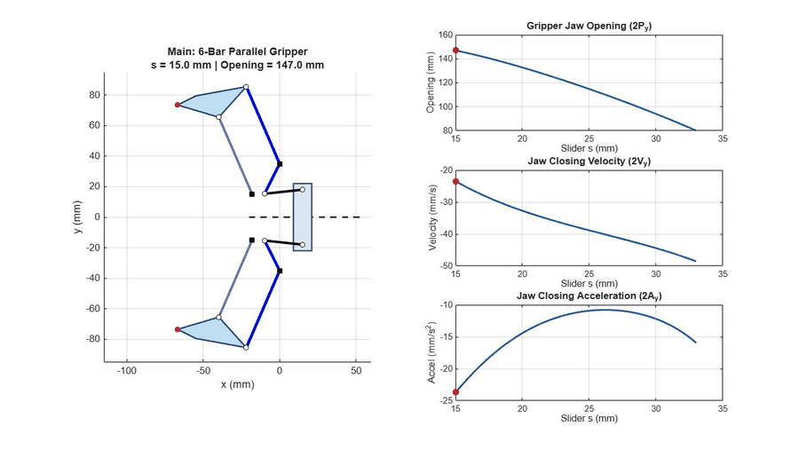
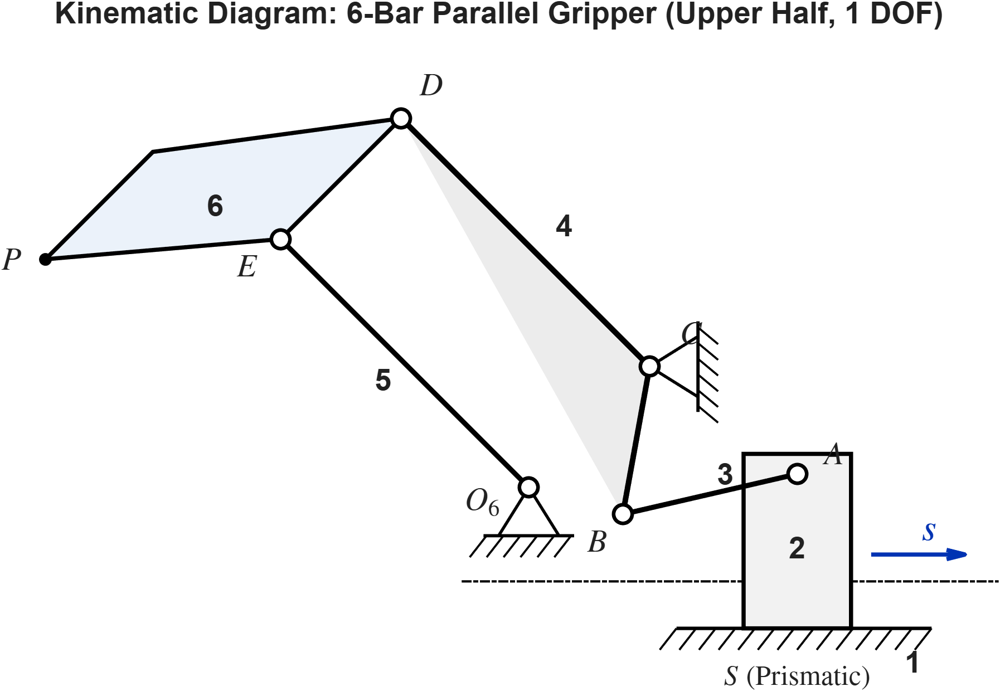
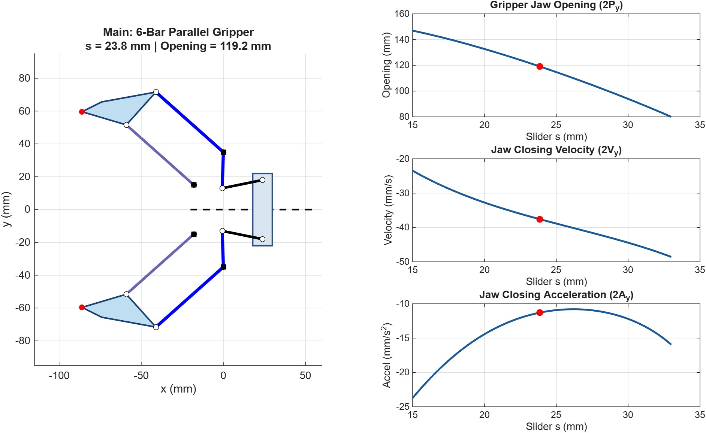
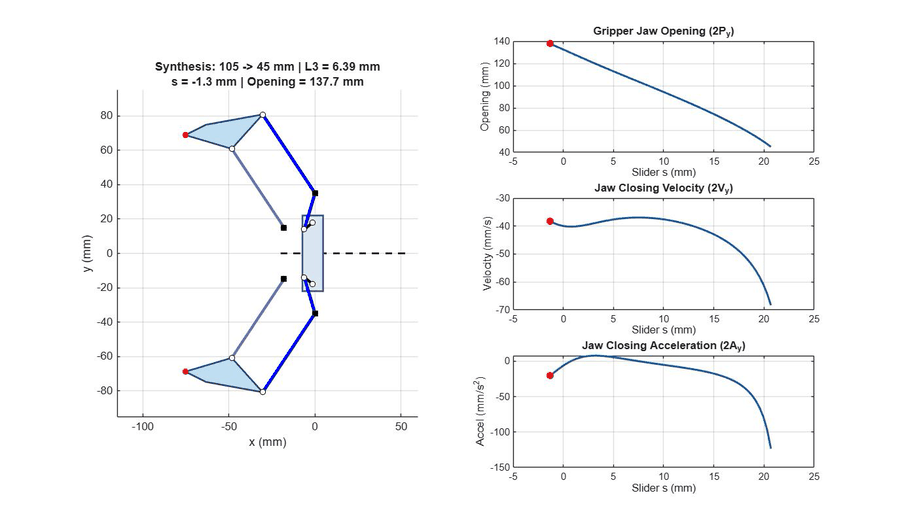

# 6-Bar Parallel Gripper

**Sakun Lohityothin** · รหัสนิสิต 6730523721 · กลุ่ม 6BG  
2103322 Mechanics of Machinery  

วิเคราะห์จลนศาสตร์ของกลไกปากคีบขนาน 6 ข้อต่อแบบสมมาตร (Symmetric 6-Bar Parallel Gripper) ด้วย MATLAB Symbolic Math Toolbox พร้อมการสังเคราะห์ขนาดข้อต่อเชิงวิเคราะห์ (Two-Position Analytical Synthesis) 

---

## ภาพเคลื่อนไหวกลไกและกราฟจลนศาสตร์

---

## ไฟล์ส่งงาน

| ไฟล์ | เนื้อหา |
| :--- | :--- |
| [Report_6BG_6730523721.docx](Report_6BG_6730523721.docx) | รายงานโครงงานฉบับสมบูรณ์ (Word) |
| [Report_6BG_6730523721.pdf](Report_6BG_6730523721.pdf) | รายงานโครงงานสำหรับพิมพ์ (PDF) |
| [Mechanism.mlx](Mechanism.mlx) | MATLAB Live Script สำหรับรันการวิเคราะห์ทั้งหมด |
| [RUN_ALL.m](RUNALL.m) | โค้ด MATLAB หลัก (Symbolic Kinematics, Synthesis และเรนเดอร์ภาพ/วิดีโอ) |
| [Kinematic_Diagram.png](Kinematic_Diagram.png) | แผนภาพจลนศาสตร์ (Kinematic Diagram) ครึ่งบนของกลไก |
| [results/main/Mechanism.avi](results/main/Mechanism.avi) | วิดีโอภาพเคลื่อนไหวพร้อมกราฟ s / v / a (Main) |
| [results/main/Render.jpg](results/main/Render.jpg) | ภาพนิ่งกลไกและกราฟ s / v / a (Main) |
| [results/bonus/Synthesis.avi](results/bonus/Synthesis.avi) | วิดีโอภาพเคลื่อนไหวหลังการสังเคราะห์ (Bonus) |
| [results/bonus/Synthesis_Render.jpg](results/bonus/Synthesis_Render.jpg) | ภาพนิ่งกลไกและกราฟหลังการสังเคราะห์ (Bonus) |

---

## แบบจำลองกลไกและการวิเคราะห์ DOF

กลไกปากคีบมีความสมมาตรระหว่างครึ่งบนและครึ่งล่าง จึงวิเคราะห์จลนศาสตร์เฉพาะ **ครึ่งบน (Upper Half)** ซึ่งประกอบด้วย 6 ข้อต่อ ขับเคลื่อนด้วยตัวเลื่อน (Slider) ตามแนวแกน $X$ ที่ความเร็วคงที่ $v_s = 10\text{ mm/s}$ แบ่งโครงสร้างออกเป็น 2 วงปิด ได้แก่ ชุดขับเคลื่อน (Driver Dyad: Slider–Link 3–Link 4a) และชุดสี่เหลี่ยมด้านขนาน (Parallelogram: Link 4b–Link 5–Jaw) เพื่อบังคับให้ปากคีบเคลื่อนที่ขนานกันตลอดช่วงการทำงาน

ลิงก์ 1 คือโครงฐานและรางสกรู, ลิงก์ 2 คือตัวเลื่อน (Slider), ลิงก์ 3 คือข้อต่อเชื่อม, ลิงก์ 4 คือแขนรูปตัว L (Bell-crank), ลิงก์ 5 คือข้อต่อประคองขนาน และลิงก์ 6 คือปากคีบ (Jaw)

| จุดต่อ | ลิงก์ที่เชื่อมต่อ | ลักษณะและชนิดของจุดต่อ | ประเภท (DOF) |
| :---: | :---: | :--- | :---: |
| $S$ | 1–2 | จุดต่อเลื่อนตามแนวแกนสกรู $X$ (Prismatic, P) | Full Joint ($J_1$) |
| $A$ | 2–3 | จุดหมุนบนตัวเลื่อน Slider (Revolute, R) | Full Joint ($J_1$) |
| $B$ | 3–4 | จุดหมุนเชื่อมข้อต่อขับเข้ากับแขนล่าง Link 4 (Revolute, R) | Full Joint ($J_1$) |
| $C$ | 1–4 | จุดหมุนหลักยึดกับโครงฐาน (Revolute, R) | Full Joint ($J_1$) |
| $D$ | 4–6 | จุดหมุนเชื่อมแขนบน Link 4 กับปากคีบ (Revolute, R) | Full Joint ($J_1$) |
| $O_6$ | 1–5 | จุดหมุนประคองยึดกับโครงฐาน (Revolute, R) | Full Joint ($J_1$) |
| $E$ | 5–6 | จุดหมุนประคองขนานบนปากคีบ (Revolute, R) | Full Joint ($J_1$) |

**การวิเคราะห์ Degree of Freedom (Kutzbach's Criterion):**  
ครึ่งบนมีจำนวนลิงก์ $L = 6$, จุดต่อแบบ 1-DOF $J_1 = 7$ (6 Revolute + 1 Prismatic) และจุดต่อแบบ 2-DOF $J_2 = 0$:

$$M = 3(L - 1) - 2J_1 - J_2 = 3(6 - 1) - 2(7) - 0 = 15 - 14 = 1\text{ DOF}$$

---

## Symbolic Analysis

ตั้งสมการวงปิดเวกเตอร์ (Vector Loop-Closure Equations) ในรูปฟังก์ชันของเวลา $t$ แล้วใช้ MATLAB Symbolic Math Toolbox หาอนุพันธ์อันดับ 1 และ 2 เทียบเวลาเพื่อแก้ระบบสมการหาความเร็วเชิงมุม ($\omega_3, \omega_4$), ความเร่งเชิงมุม ($\alpha_4$) และจลนศาสตร์ของระยะเปิด–ปิดปากคีบรวม ($2P_y, 2V_y, 2A_y$):

$$s(t) + L_3\cos\theta_3(t) - x_C - L_{4a}\cos\theta_4(t) = 0$$
$$y_A + L_3\sin\theta_3(t) - y_C - L_{4a}\sin\theta_4(t) = 0$$

$$P_y(t) = y_C + L_{4b}\sin(\theta_4(t) + \beta) + dy_P$$
$$V_y = \frac{dP_y}{dt} = L_{4b}\cos(\theta_4 + \beta)\,\omega_4, \qquad A_y = \frac{d^2P_y}{dt^2} = L_{4b}\cos(\theta_4 + \beta)\,\alpha_4 - L_{4b}\sin(\theta_4 + \beta)\,\omega_4^2$$

จากการจำลองหลัก (Main Simulation) ที่ช่วงชัก $s = 15.0 \to 33.0\text{ mm}$ ($L_3 = 25.0\text{ mm}$, $v_s = 10\text{ mm/s}$) ระยะเปิดปากคีบรวมลดลงอย่างต่อเนื่องจากประมาณ $147\text{ mm}$ เหลือ $80\text{ mm}$ (ที่กึ่งกลางช่วงชัก $s = 23.8\text{ mm}$ ปากคีบเปิด $119.2\text{ mm}$) โดยความเร็วและแรงเฉื่อยเปลี่ยนแปลงอย่างราบเรียบตลอดช่วงการทำงาน

---

## Synthesis 

ตั้งโจทย์การสังเคราะห์แบบ **Two-Position Analytical Synthesis** ให้ระยะเปิด–ปิดปากคีบรวม ($2P_y$) เปลี่ยนจากเปิดสุด **105.0 mm** เหลือปิดสุด **45.0 mm** ภายในระยะชักตัวเลื่อน $\Delta s = 22.0\text{ mm}$ โดยแก้สมการเงื่อนไขความยาวคงที่ของข้อต่อ $L_3$:

$$(x_{B1} - s_1)^2 + (y_{B1} - y_A)^2 = L_3^2, \qquad (x_{B2} - (s_1 + \Delta s))^2 + (y_{B2} - y_A)^2 = L_3^2$$

* **ผลลัพธ์จากการสังเคราะห์:** ได้ความยาวข้อต่อขับ $L_3 = 6.39\text{ mm}$ และช่วงชักตัวเลื่อน $s \approx -1.3 \to 20.7\text{ mm}$ (ที่ $s = 9.5\text{ mm}$ ปากคีบเปิด $96.2\text{ mm}$)
* **ข้อสังเกตเชิงวิศวกรรม:** ช่วงปลายชักเข้าใกล้ $s = 20.7\text{ mm}$ ความเร็วปิด ($2V_y \to -68\text{ mm/s}$) และความเร่ง ($2A_y \to -123\text{ mm/s}^2$) เพิ่มสูงขึ้นเร็ว เนื่องจาก $L_3$ สั้นมากเมื่อเทียบกับ $L_{4a} = 22\text{ mm}$ ทำให้เข้าใกล้ Toggle Position ในการออกแบบจริงจึงควรปรับระยะชักหรือพิกัด $y_A$ เพื่อรักษามุมส่งกำลังให้อยู่ในช่วงปลอดภัย $40^\circ\text{–}140^\circ$

---

## การรัน

1. ดาวน์โหลดหรือ Clone โครงการทั้งหมดลงในเครื่อง
2. เปิดโปรแกรม **MATLAB** (ต้องติดตั้ง **Symbolic Math Toolbox**)
3. เปิดไฟล์ `Mechanism.mlx` แล้วกด **Run All** หรือรันไฟล์ `RUNALL.m` โดยตรง
4. ไฟล์ภาพและวิดีโอผลลัพธ์จะถูกบันทึกอัตโนมัติในโฟลเดอร์ `results/main/` และ `results/bonus/`

แบบจำลองใช้สมมุติฐานชิ้นส่วนแข็งเกร็ง (Rigid Bodies) ตัวเลื่อนเคลื่อนที่ด้วยความเร็วคงที่ หน่วยที่ใช้คือ `mm`, `s`, `rad`
